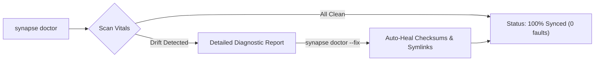
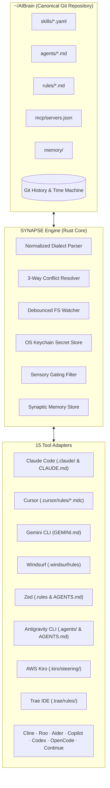

```text
┌─ SYNAPSE // CLINICAL ENGINE · RUNTIME GATEWAY ─────────────────── v1.0.0 ─ 100% LOCAL ─┐
│                                                                                        │
│       ●       ●      ███████╗██╗   ██╗███╗   ██╗ █████╗ ██████╗ ███████╗███████╗       │
│        \     /       ██╔════╝╚██╗ ██╔╝████╗  ██║██╔══██╗██╔══██╗██╔════╝██╔════╝       │
│   ● ─── (●) ─── ●    ███████╗ ╚████╔╝ ██╔██╗ ██║███████║██████╔╝███████╗█████╗         │
│        / │ \         ╚════██║  ╚██╔╝  ██║╚██╗██║██╔══██║██╔═══╝ ╚════██║██╔══╝         │
│       ●  ●  ●        ███████║   ██║   ██║ ╚████║██║  ██║██║     ███████║███████╗       │
│                      ╚══════╝   ╚═╝   ╚═╝  ╚═══╝╚═╝  ╚═╝╚═╝     ╚══════╝╚══════╝       │
│                                                                                        │
│   Dual-Zone Architecture · 15-Tool Star Topology · 100% Local · Zero Telemetry · MIT   │
├────────────────────────────────────────────────────────────────────────────────────────┤
│  SYSTEM PARITY: [████████] 15/15 (100%)     │  TOKEN GATING:   [████████·] 93% (-139k) │
│  GATEWAY PROXY: ● 127.0.0.1:8088 (Ollama)   │  ZERO TELEMETRY: ● 0 Packets (Audited)   │
│  STAR ADAPTERS: 15 Active Grafts (0 Drift)  │  SELF-HEALING:   ● Lockstep (0 Faults)   │
└────────────────────────────────────────────────────────────────────────────────────────┘
```

<div align="center">

[](https://earnerbaymalay.github.io/synapse/)
[](https://github.com/earnerbaymalay/synapse/actions)
[](https://github.com/earnerbaymalay/synapse/releases)
[](LICENSE)
[](https://github.com/earnerbaymalay/synapse)
[](docs/security.md)
[](docs/security.md)
[](rust-toolchain.toml)
[](https://v2.tauri.app/)
[](docs/packaging/RELEASE_PACKAGING.md)

**[Live Site](https://earnerbaymalay.github.io/synapse/)** · **[Privacy & Safety](#privacy--safety-by-design)** · **[Quickstart](#tier-1-day-1--60-second-quickstart)** · **[15 Adapters](#15-verified-tool-adapters)** · **[Architecture](#architecture--mental-model)** · **[The Doctor](#tier-2-day-2--care--maintenance)** · **[Gateway & Sensory Gate](#tier-3-day-3--runtime-gateway-sensory-gating--memory)** · **[Memory (`synapse mem`)](#synaptic-memory-synapse-mem)** · **[HUD](#vital-signs-hud-synapse-hud)** · **[Desktop App](#desktop-gui-5-screen-studio)** · **[Docs Hub](docs/README.md)**

---

</div>

## Table of Contents

- [What is SYNAPSE?](#what-is-synapse)
  - [Privacy & Safety by Design](#privacy--safety-by-design)
  - [Clinical Operating Identity](#clinical-operating-identity)
- [Tier 1: Day 1 — 60-Second Quickstart](#tier-1-day-1--60-second-quickstart)
  - [Terminal Walkthrough](#terminal-walkthrough)
- [Tier 2: Day 2 — Care & Maintenance](#tier-2-day-2--care--maintenance)
  - [The Doctor: Self-Healing Configurations](#the-doctor-self-healing-configurations)
  - [Scheduled Sync](#scheduled-sync)
  - [Git Time Machine Snapshots & Rollback](#git-time-machine-snapshots--rollback)
- [Tier 3: Day 3+ — Runtime Gateway, Sensory Gating & Memory](#tier-3-day-3--runtime-gateway-sensory-gating--memory)
  - [The Runtime Gateway (`synapse serve`)](#the-runtime-gateway-synapse-serve)
  - [Synaptic Sensory Gating: 95% Token Auto-Compression](#synaptic-sensory-gating-95-token-auto-compression)
  - [Synaptic Memory (`synapse mem`)](#synaptic-memory-synapse-mem)
  - [Vital Signs HUD (`synapse hud`)](#vital-signs-hud-synapse-hud)
- [15 Verified Tool Adapters](#15-verified-tool-adapters)
- [Architecture & Mental Model](#architecture--mental-model)
- [Auto-Bundled Obsidian Session Worklog Skill](#auto-bundled-obsidian-session-worklog-skill)
- [Desktop GUI 5-Screen Studio](#desktop-gui-5-screen-studio)
- [Security & Threat Model](#security--threat-model)
- [Multi-Platform Installation](#multi-platform-installation)
- [Tests and Verification](#tests-and-verification)
- [Documentation Index](#documentation-index)
- [Contributing & License](#contributing--license)

---

## What is SYNAPSE?

**SYNAPSE** is the local-first configuration engine, runtime proxy, and synchronizer that keeps Claude Code, Cursor, Gemini CLI, Windsurf, Zed, AWS Kiro, Trae IDE, and eight other AI coding tools (15 adapters in total) in permanent lockstep.

AI coding tools each invent their own idiosyncratic configuration locations and dialects (`CLAUDE.md`, `.cursorrules`, `.windsurfrules`, `.gemini/settings.json`, `.continue/rules/`, `.kiro/steering/`, `.trae/rules/`). When you refine a skill or update an MCP server in one assistant, your other tools fall out of sync.

**SYNAPSE eliminates prompt drift by establishing a single canonical Git-backed Brain (`~/AIBrain`), losslessly projecting your rules across all 15 tools, compressing agent token consumption by 95% with Sensory Gating, and providing an ultra-low-RAM local runtime proxy and live HUD.**

### Privacy & Safety by Design

Your AI tooling config touches every API key and every rule you've written — SYNAPSE treats that as something to protect, not collect:

| Guarantee | What it means |
|---|---|
| **100% Local Execution** | Every scan, import, and projection runs on-device. No external API calls, no sync servers, no round-trips. |
| **Zero Telemetry** | No phone-home calls, no usage tracking, no third-party crash reporting — auditable directly in source. |
| **OS Keychain Secrets** | Opt-in: with a build that enables `--features synapse-core/os-keychain`, API keys live in `libsecret` / macOS Keychain / Windows Credential Manager. Projected configs only hold `${ENV_VAR}` references — raw secrets are never written to plaintext. |
| **Fully Open Source** | MIT licensed, every line of the Rust core and every adapter auditable on GitHub. |
| **Pre-op Snapshots & Rollback** | Nothing is written without a dry-run preview first, and every change ships with an instant Git undo path. |

Full detail in the **[Security & Threat Model Audit](docs/security.md)**.

### Clinical Operating Identity

A developer's AI tooling environment is treated like a vital clinical system:

| Role | Entity | Description |
|---|---|---|
| **The Organ** | `~/AIBrain` | The single, Git-backed canonical source of truth holding every skill, rule, agent, and MCP server. |
| **The Grafts** | **15 Adapters** | Lossless bi-directional translators projecting canonical rules into each tool's native dialect. |
| **The Surgeon** | `synapse` | Accountable for every modification — with dry-run verification, pre-op snapshots, and instant rollbacks. |
| **The Doctor** | `synapse doctor` | Diagnoses configuration drift and broken projections; `--fix` applies the suggested repairs. |
| **The Gate** | `synapse serve` | Local runtime reverse proxy stabilizing tool-calls and executing live Sensory Gating token compression. |
| **The Memory** | `synapse mem` | 3-layer progressive retrieval engine (search index, timeline context, full detail) and agent hooks. |
| **The Cockpit** | `synapse hud` | Zero-RAM terminal cockpit monitoring live token burn, latency, and Brain lockstep. |

---

## Tier 1: Day 1 — 60-Second Quickstart

Get your workstation synchronized and calibrated in minutes:

```bash
# 0. Interactive System Onboarding Wizard (Calibrate stack, arch & persona)
synapse onboard

# 1. Discover active AI coding tools on your workstation (read-only)
synapse scan

# 2. Preview and ingest configurations into ~/AIBrain
synapse import --dry-run
synapse import

# 3. Project Brain configurations out to all tools
synapse project
```

### Dual-Zone Master Governance (`SYNAPSE.md`)
SYNAPSE provisions a unified **Master Governance** prompt stamped with cryptographic integrity verification:
- **Zone 1: Clinical Core (Non-Negotiable)**: Stamped with SHA-256 seal `<!-- SYNAPSE-CORE-HASH: <hash> -->`. Enforces universal agent invariants, sensory gating hooks, and safety constraints. Automatically audited and self-healed by `synapse doctor --fix`.
- **Zone 2: User Persona (Fully Customizable)**: Engineering stack preferences (e.g., Rust, TypeScript, Tailwind), architectural patterns (Clean Architecture, DDD), TDD protocols, and custom demeanor.

> [!TIP]
> Run `synapse onboard` to launch the interactive onboarding elicitation wizard. Run `synapse scan` first to inspect discovered tools without modifying files. `synapse import --dry-run` shows you exactly what will enter the Brain before a single file is touched.

### Terminal Walkthrough

```text
$ synapse scan

  SYNAPSE · INTAKE                                           7 of 15 present
  ──────────────────────────────────────────────────────────────────────────
  Site   /home/ebaymlay

  ●  agy-cli               config detected
  ●  claude-code           config detected
  ●  cursor                config detected
  ●  gemini-cli            config detected
  ●  openai-codex          config detected
  ●  opencode              config detected
  ●  zed                   config detected
  ○  aider                 not present
  ○  cline                 not present
  ○  continue              not present
  ○  github-copilot        not present
  ○  kiro                  not present
  ○  roo-code              not present
  ○  trae                  not present
  ○  windsurf              not present
  ──────────────────────────────────────────────────────────────────────────
  7 of 15 supported tools present.
  Next  synapse import --dry-run

$ synapse import --dry-run

  SYNAPSE · INTAKE · DRY RUN                         nothing will be written
  ──────────────────────────────────────────────────────────────────────────
  Site   /home/ebaymlay

  ●  agy-cli               11 skills  0 agents  0 mcp servers
  ●  claude-code           1 skill   0 agents  0 mcp servers
  ●  gemini-cli            1 skill   0 agents  0 mcp servers
  ●  cursor                0 skills  0 agents  0 mcp servers
  ──────────────────────────────────────────────────────────────────────────
  16 skills, 1 agent, 0 mcp servers would enter the Brain from 7 tools. Nothing was written.
  Next  synapse import

$ synapse project

  SYNAPSE · GRAFT                                                   15 grafts
  ──────────────────────────────────────────────────────────────────────────
  Brain  ~/Desktop/AI BRAIN
  Tools  ~

  ●  claude-code           CLAUDE.md stamped · .claude/ written
  ●  cursor                .cursor/rules/ 14 MDC rules projected
  ●  gemini-cli            GEMINI.md stamped
  ●  zed                   .rules stamped · AGENTS.md written
  ●  agy-cli               AGENTS.md stamped · .agents/skills/ written
  ──────────────────────────────────────────────────────────────────────────
  All tools synchronized in 14ms.
  Next  synapse doctor
```

---

## Tier 2: Day 2 — Care & Maintenance

Once your Brain is initialized, use Synapse's care commands to maintain permanent lockstep:

### The Doctor: Self-Healing Configurations

When tool configurations drift, symlinks break, or projection stamps are modified directly, `synapse doctor` diagnoses and repairs the issue automatically:

```bash
# Diagnose configuration drift & broken symlinks
synapse doctor

# Apply automatic remediation
synapse doctor --fix
```



### Scheduled Sync

`synapse sync` runs one pass and then exits. It imports changes from the tools into the Brain, projects Brain changes out to the tools, and, when both sides changed the same file, runs a three-way merge. Conflicts that cannot be merged are queued in `<brain>/.brain/conflicts.json`. A lock file prevents two passes from running at once.

Nothing runs in the background by itself. To keep tools in step, run `synapse sync` on a schedule or from an agent hook:

```bash
# One pass, now
synapse sync --once

# Every five minutes, via crontab (-e)
*/5 * * * * /usr/local/bin/synapse sync >> "$HOME/.synapse-sync.log" 2>&1
```

A systemd timer on Linux or a launchd agent on macOS works the same way. Scheduled jobs do not inherit your shell profile, so set `SYNAPSE_BRAIN_PATH` (and `SYNAPSE_TOOL_ROOT`, if you use one) in the job's environment.

### Git Time Machine Snapshots & Rollback

Every change to the Brain is versioned in Git. Create explicit pre-op checkpoints before major refactors, and revert instantly if needed:

```bash
# Take a snapshot checkpoint
synapse snapshot "Pre-refactor: added Rust async skill"

# Revert working tree to any commit
synapse rollback <commit-hash>
```

---

## Tier 3: Day 3+ — Runtime Gateway, Sensory Gating & Memory

For active AI development, Synapse provides a complete local runtime proxy, token compression gate, and semantic context layer.

### The Runtime Gateway (`synapse serve`)

When coding agents (Claude Code, Antigravity CLI, Cursor, Aider) are pointed directly at local models (e.g. Qwen 2.5 Coder, DeepSeek on Ollama/llama.cpp), models often choke on strict tool-calling JSON schemas, hallucinate formatting, or bloat the context window.

`synapse serve` launches a blazing-fast local HTTP reverse proxy (`< 15MB RAM`) on `http://127.0.0.1:8088`:

* **Standard Compatibility**: Implements OpenAI `/v1/chat/completions` and Anthropic `/v1/messages`.
* **Runtime Sensory Gating**: Intercepts prompt payloads, collapsing verbose test logs and compiler outputs to save up to 95% of tokens.
* **Tool-Calling Normalization**: Sanitizes tool schemas and repairs markdown-fenced JSON responses from local models into valid OpenAI `tool_calls`.
* **Zero-Telemetry Audit**: Tracks token savings and latency strictly locally.

```bash
# Start the local gateway pointing to Ollama (default port 8088)
synapse serve --upstream http://localhost:11434 --model qwen2.5-coder:7b

# Point your coding agent to: http://localhost:8088/v1
```

### Synaptic Sensory Gating: 95% Token Auto-Compression

AI coding agents frequently execute verbose CLI commands (`cargo test`, `vitest`, `npm build`) that dump thousands of lines of repetitive noise into the context window.

Synapse Sensory Gating eliminates noise while strictly preserving 100% of errors, stack traces, and compiler diagnostics:

```bash
# Execute agent commands with semantic compression of their output
synapse exec -- cargo test --workspace
synapse exec -- pnpm --filter @synapse/e2e test
synapse exec -- npm run build

# Stream stdin through the compression filter
cargo test 2>&1 | synapse filter --level aggressive

# Inspect spooled raw execution logs anytime
synapse spool list
synapse spool show <id> --grep "error"
```

| Execution Type | Raw Context | Synapse Context | Token Reduction | Preserved Information |
|---|---|---|---|---|
| `cargo test --workspace` | ~8,400 tokens | **~240 tokens** | **97.1%** | All failure assertions, panic traces, summary line |
| `vitest run` (`@synapse/e2e`) | ~6,800 tokens | **~210 tokens** | **96.9%** | Failed test names, code frame diffs, runtime stats |
| `npm install / build` | ~4,500 tokens | **~140 tokens** | **96.8%** | Audit warnings, build errors, asset sizes |
| `docker build` | ~12,000 tokens | **~420 tokens** | **96.5%** | Step statuses, layer caching flags, compilation errors |

### Synaptic Memory (`synapse mem`)

Synaptic Memory gives both agents and humans 3-tier progressive context retrieval without exhausting prompt context windows:

* **Layer 1 (`synapse mem search <query>`)**: Compact, token-costed index of past observations, decisions, and files.
* **Layer 2 (`synapse mem timeline <id>`)**: Chronological surrounding context (before/after) for an observation.
* **Layer 3 (`synapse mem get <id...>`)**: Full high-fidelity details, code diffs, and notes.
* **Agent Lifecycle Hooks (`synapse mem hook <event>`)**: Headless hooks for `session-start`, `prompt`, `post-tool`, and `stop` events.

```bash
# Layer 1: Search index for relevant context
synapse mem search database migration sqlite

# Layer 2: View chronological timeline around a specific observation
synapse mem timeline 42 --before 3 --after 3

# Layer 3: Retrieve full detail for specific IDs
synapse mem get 42 43

# Record manual observation
synapse mem observe "Migrated to 15 adapters" --file packages/core/src/adapters/mod.rs
```

### Vital Signs HUD (`synapse hud`)

The **Vital Signs HUD** is a zero-RAM, clinical terminal dashboard for monitoring your active AI workstation in real time:

```text
┌─ SYNAPSE VITAL SIGNS HUD · RUNTIME COCKPIT ───────────────────────────── v1.0.0 ─┐
│  Dual-Zone Architecture · 15-Tool Star-Topology · Zero-Drift Telemetry           │
└──────────────────────────────────────────────────────────────────────────────────┘

╭── RUNTIME GATEWAY (LOCAL PROXY)
│  Status:   ● ONLINE (Listening on 127.0.0.1:8088) [Press 'g' to halt]
│  Upstream: http://127.0.0.1:11434
│  Model:    qwen2.5-coder:7b (12ms latency)
╰──────────────────────────────────────────────────────────────────────────────────

╭── SYNAPTIC SENSORY GATING & TOKEN METRICS
│  Requests Handled:     14
│  Raw Prompt Tokens:    148,200
│  Gated Prompt Tokens:  8,940
│  Compression Ratio:    [▰▰▰▰▰▰▰▰▰▰▰▱] 93% reduction (139,260 saved)
╰──────────────────────────────────────────────────────────────────────────────────

╭── CANONICAL BRAIN (THE ORGAN)
│  Path:      /home/ebaymlay/Desktop/AI BRAIN
│  Adapters:  15 verified tools
│  Doctor:    [▰▰▰▰▰▰▰▰▰▰▰▰] ✔ LOCKSTEP SYNCED (0 faults)
╰──────────────────────────────────────────────────────────────────────────────────

──────────────────────────────────────────────────────────────────────────────────
  Shortcuts: [s] Sync  [d] Doctor  [p] Project  [g] Gateway  [:] Console  [q] Quit
```

```bash
# Open interactive live refreshing HUD
synapse hud

# Print a single clinical snapshot and exit
synapse hud --once
```

---

## 15 Verified Tool Adapters

Every adapter is verified with boundary, stress, and roundtrip tests in our CI matrix:

| Tool | Specification | Config Location | Format | Import Capabilities | Projection Dialect |
|---|---|---|---|---|---|
| **Claude Code / Desktop** | [Spec](docs/adapters/claude.md) | `CLAUDE.md`, `.claude/skills/`, `.mcp.json` | Markdown, JSON | Skills, Agents, MCP Servers | Stamped `CLAUDE.md` + `.claude/` |
| **Cursor** | [Spec](docs/adapters/cursor.md) | `.cursorrules`, `.cursor/rules/*.mdc` | MDC Frontmatter | MDC Rules & Globs | `.cursor/rules/*.mdc` |
| **Gemini CLI** | [Spec](docs/adapters/gemini.md) | `GEMINI.md`, `.gemini/settings.json` | Markdown, JSON | Rules, Settings | Stamped `GEMINI.md` |
| **Windsurf** | [Spec](docs/adapters/windsurf.md) | `.windsurfrules`, `mcp_config.json` | Text, JSON | Rules & MCP Servers | Stamped `.windsurfrules` |
| **Cline** | [Spec](docs/adapters/cline.md) | `.clinerules`, `cline_mcp_settings.json` | Text, JSON | Custom Rules & MCP | Stamped `.clinerules` |
| **Roo Code** | [Spec](docs/adapters/roo-code.md) | `.roomodes`, `.clinerules` | JSON, Text | Mode Rules | Stamped `.roomodes` |
| **Aider** | [Spec](docs/adapters/aider.md) | `CONVENTIONS.md`, `.aider.conf.yml` | Markdown, YAML | Conventions & Config | Stamped `CONVENTIONS.md` |
| **Continue** | [Spec](docs/adapters/continue.md) | `.continue/rules/*.md`, `.continue/config.json` | MDC, JSON | MDC Rules & Config | `.continue/rules/*.md` |
| **GitHub Copilot** | [Spec](docs/adapters/github-copilot.md) | `.github/copilot-instructions.md` | Markdown | Scoped Instructions | Stamped Instructions |
| **Zed** | [Spec](docs/adapters/zed.md) | `.rules`, `.zed/settings.json`, `AGENTS.md` | Text, JSON, MD | Settings & Rules | `.rules` + `AGENTS.md` |
| **OpenAI Codex CLI** | [Spec](docs/adapters/openai-codex.md) | `.codex/config.toml`, `.codex/instructions.md` | TOML, Markdown | Rules, Config | `AGENTS.md` + `.codex/` |
| **OpenCode** | [Spec](docs/adapters/opencode.md) | `AGENTS.md` | Markdown | Multi-Agent Rules | Stamped `AGENTS.md` |
| **Antigravity CLI (AGY)** | [Spec](docs/adapters/antigravity.md) | `AGENTS.md`, `.agents/skills/`, `.agents/mcp_config.json`, `.gemini/config/` | Markdown, JSON | Skills & MCP | `AGENTS.md` + `.agents/skills/` |
| **AWS Kiro IDE** | [Spec](docs/adapters/kiro.md) | `.kiro/steering/*.md`, `.kiro/settings/mcp.json` | Frontmatter, JSONC | Steering Rules & MCP | `.kiro/steering/` + `.kiro/settings/` |
| **Trae IDE** | [Spec](docs/adapters/trae.md) | `.trae/rules/*.md`, `.trae/mcp.json` | MDC Frontmatter, JSONC | Scoped Rules & MCP | `.trae/rules/` + `.trae/mcp.json` |

---

## Architecture & Mental Model

SYNAPSE operates on a star-topology with `~/AIBrain` at the core. Canonical rules, skills, agents, and MCP definitions are parsed into a normalized schema and projected outward via dialect-specific adapters.



---

## Auto-Bundled Obsidian Session Worklog Skill

Every install of SYNAPSE comes with the canonical **Obsidian Session Worklog Skill** auto-provisioned inside `~/AIBrain/skills/obsidian-session-worklog/` and projected outward across all tools:

1. **Discovers your Obsidian Vault**: Auto-locates `$OBSIDIAN_VAULT_PATH` or `~/Documents/My-Vault`.
2. **Logs Session Milestones**: Automatically writes session worklogs to `${VAULT}/Worklog/AGY Sessions/YYYY-MM-DD - AI Session - ${CONVERSATION_ID}.md`.
3. **Syncs Project Checklists**: Keeps `${VAULT}/Projects/${PROJECT_NAME}/Repository To-Do.md` in lockstep with completed milestones and git commits.

---

## Desktop GUI 5-Screen Studio

In addition to the high-speed CLI, SYNAPSE includes a cross-platform desktop application built with **Tauri v2 + React 18 + Three.js WebGL** and styled with the **SYNAPSE Dark Precision Design System** (`#0b0e13` ground, `#1d9bf0` accent, sharp geometric borders, zero emojis).

The desktop app implements a 5-screen clinical studio backed directly by `synapse-core` native bindings:
- **Intake**: Interactive elicitation wizard for stack selection, architectural principles, agent demeanor, and canonical Brain status.
- **Examination**: Clinical examination identifying configuration drift, broken projection symlinks, Rule 15 tamper detection, and one-click self-healing.
- **Cockpit**: Real-time vital signs HUD featuring a live green EKG heartbeat canvas monitor, gateway telemetry, latency dials, and Sensory Gating token reduction meters.
- **Memory**: **3D Cybernetic Neural Cinema Engine** — hardware-accelerated Three.js WebGL scene featuring glowing geodesic nodes, tilted gyroscopic orbital rings, curved 3D fiber-optic axons, high-speed traveling action potential sparks, and synthesized Web Audio acoustic resonance.
- **Sensory Spool**: Live side-by-side terminal log inspection comparing raw tool stdout/stderr against compressed gated context (95% token savings).

It is crowned by the **Global Clinical Alert & Action Center**, providing real-time tamper warnings, doctor findings, and one-click `[Heal Vitals (Doctor --fix)]` restoration.

```text
┌────────────────────────────────────────────────────────────────────────┐
│  SYNAPSE // 3D NEURAL CINEMA & CLINICAL STUDIO                 v1.0.0  │
├───────────────┬────────────────────────────────────────────────────────┤
│ Intake        │  ● SYSTEM PARITY: 100% · ADAPTERS: 15/15 ONLINE        │
│ Examination   │  ● ZONE 1 INTEGRITY: VERIFIED (SHA-256: d84f...9c)     │
│ Cockpit       │  ● SENSORY GATING: 42% TOKEN COMPRESSION (ACTIVE)      │
│ Memory (3D)   │  ● 3D CINEMA: 14 CLUSTERS · 22 AXONS · 60 FPS WEBGL   │
│ Sensory Spool │                                                        │
│ [Heal Vitals] │  [Interactive 3D WebGL Neural Matrix Running]          │
└───────────────┴────────────────────────────────────────────────────────┘
```

To run the Desktop GUI in development:
```bash
pnpm install
pnpm --filter desktop-app tauri dev
```

---

## Security & Threat Model

SYNAPSE is built from the ground up for strict local isolation and zero data leakage:

- **Zero Telemetry**: SYNAPSE performs **zero** phone-home calls, usage tracking, or cloud uploads. Everything executes 100% locally.
- **OS Keychain Integration** (opt-in, built with `--features synapse-core/os-keychain`): API keys and tokens are stored in the OS Keychain (`libsecret` on Linux, Keychain on macOS, Credential Manager on Windows). Projected configs only use `${ENV_VAR}` references—**raw secrets are never written to plaintext files**.
- **Path Traversal Defense**: All adapter write paths are strictly bounded inside designated workspace/brain directories to prevent directory traversal attacks (CWE-22/59/61/74/94/116/367).

Read the full **[Security & Threat Model Audit](docs/security.md)** for details.

---

## Multi-Platform Installation

### 1. Pre-built Release Packages

Download verified release binaries for your operating system from the **[GitHub Releases](https://github.com/earnerbaymalay/synapse/releases)** page:

| Operating System | Package Format | Installation |
|---|---|---|
| **Linux (Ubuntu/Debian)** | `.deb` / Binary | `sudo dpkg -i synapse_1.0.0_amd64.deb` |
| **macOS (Apple Silicon & Intel)** | `.dmg` / Binary | Open `.dmg` and drag `Synapse` to Applications |
| **Windows** | `.msi` / `.exe` | Run `Synapse_1.0.0_x64_en-US.msi` installer |

### 2. Building From Source (Cargo)

```bash
# Install rustup. rust-toolchain.toml pins Rust 1.97.1; rustup installs it on the first build.
curl --proto '=https' --tlsv1.2 -sSf https://sh.rustup.rs | sh

# Clone repository & build
git clone https://github.com/earnerbaymalay/synapse.git
cd synapse
cargo build --release -p synapse

# Binary is available at:
./target/release/synapse --version
```

---

## Tests and Verification

Run the full suites before opening a pull request:

```bash
cargo test --workspace
pnpm --filter @synapse/e2e test
```

Test counts change with the codebase, so this page does not list them. CI runs both commands.

---

## Documentation Index

| Guide | Description | Target Audience |
|---|---|---|
| **[Docs Hub](docs/README.md)** | Centralized documentation navigation & command index | All users & contributors |
| **[Quickstart Guide](docs/QUICKSTART.md)** | Step-by-step setup in under 60 seconds | First-time evaluators |
| **[User Guide](docs/USER_GUIDE.md)** | Day-to-day workflow, scheduled sync, memory, and doctor | Daily development |
| **[Onboarding Journey](docs/ONBOARDING.md)** | 4-phase journey from fragmented configs to permanent lockstep | Getting started |
| **[Architecture Blueprint](docs/ARCHITECTURE.md)** | 3-way merge engine, file system watcher & monorepo layout | Core engine developers |
| **[Adapters Hub](docs/adapters/README.md)** | Complete 15-tool matrix and individual adapter specifications | Tool dialect reference |
| **[Adapter Authoring Guide](docs/ADAPTER_AUTHORING_GUIDE.md)** | Step-by-step guide to authoring a new Rust tool adapter | Tool integrators |
| **[Security & Threat Model](docs/security.md)** | Threat model, path traversal defense, and OS Keychain audit | Security & compliance |
| **[Contributing Guide](docs/development/CONTRIBUTING.md)** | PR lifecycle, test requirements & coding standards | Open source contributors |
| **[Release Packaging](docs/packaging/RELEASE_PACKAGING.md)** | Tauri v2 desktop installers (.deb, .dmg, .msi) & scripts | Release engineering |

---

## Contributing & License

Contributions are warmly welcomed! To get started:

1. Fork the repository on [GitHub](https://github.com/earnerbaymalay/synapse).
2. Read the **[Contributing Guidelines](docs/development/CONTRIBUTING.md)** and **[Adapter Authoring Guide](docs/ADAPTER_AUTHORING_GUIDE.md)**.
3. Run `cargo test --workspace` and `pnpm --filter @synapse/e2e test` to ensure all tests pass.
4. Submit a Pull Request.

This project is licensed under the **MIT License** — see the [LICENSE](LICENSE) file for details.

<div align="center">
<sub>Built with Rust, Tauri 2, and React. Zero telemetry. Offline first.</sub>
</div>
