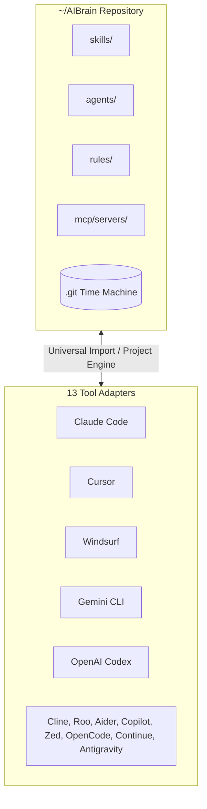
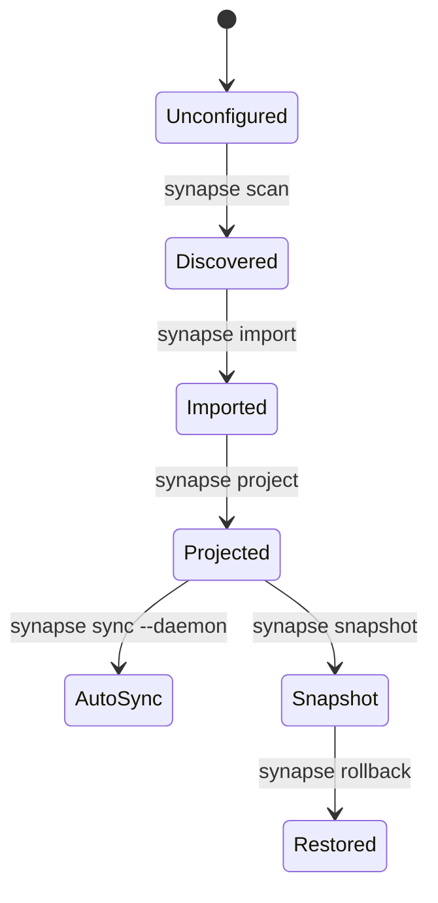
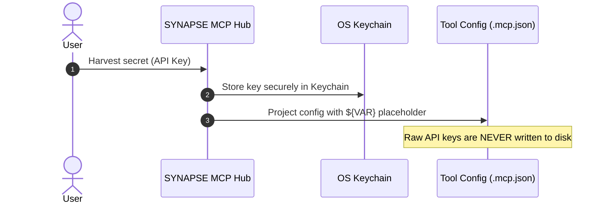
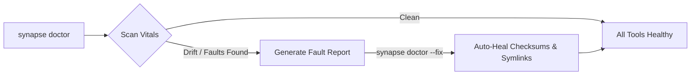

# SYNAPSE User Guide
### The Clinical Engine for AI Context — One Brain. All Models.

Welcome to the **SYNAPSE** User Guide. This document provides a complete reference for managing your AI coding tool configurations using the `synapse` CLI and the React desktop application.

---

## Table of Contents

1. [Core Concepts](#1-core-concepts)
2. [CLI Command Reference](#2-cli-command-reference)
   - [synapse scan](#synapse-scan)
   - [synapse import](#synapse-import)
   - [synapse project](#synapse-project)
   - [synapse sync](#synapse-sync)
   - [synapse doctor](#synapse-doctor)
   - [synapse snapshot & rollback](#synapse-snapshot--rollback)
   - [synapse exec & filter](#synapse-exec--filter-synaptic-auto-compression)
   - [synapse spool](#synapse-spool)
   - [synapse serve](#synapse-serve-runtime-gateway)
   - [synapse mem](#synapse-mem-3-layer-context-retrieval)
   - [synapse hud](#synapse-hud-vital-signs-cockpit)
3. [Supported Tool Adapters (15/15)](#3-supported-tool-adapters-1515)
4. [Desktop GUI Application](#4-desktop-gui-application)
5. [MCP Hub & OS Keychain Integration](#5-mcp-hub--os-keychain-integration)
6. [Doctor Diagnostic Engine](#6-doctor-diagnostic-engine)
7. [Troubleshooting & FAQ](#7-troubleshooting--faq)

---

## 1. Core Concepts

SYNAPSE unifies configuration management across all AI tools installed on your system using a single, Git-backed directory — **the Brain** (`~/AIBrain`).



> [!NOTE]
> **The Three-Command Loop:**  
> `synapse scan` → `synapse import` → `synapse project`.  
> Once imported into `~/AIBrain`, use `synapse sync --daemon` to keep every tool automatically in lockstep.

### Inbuilt Obsidian Session Worklog Skill
Every freshly initialized or imported Brain automatically provisions the canonical `obsidian-session-worklog` skill into `~/AIBrain/skills/obsidian-session-worklog/` and projects it across all tools:
- **Automatic Vault Discovery**: Locates `$OBSIDIAN_VAULT_PATH` or fallback `~/Documents/My-Vault`.
- **Session Worklog Tracking**: Standardized markdown note creation at `${VAULT}/Worklog/AGY Sessions/YYYY-MM-DD - AI Session - ${CONVERSATION_ID}.md`.
- **Cross-Tool Projection**: Projected as `.claude/skills/`, `.cursor/rules/`, `.agents/skills/`, and `.continue/rules/` across all 13 coding assistants.

---

## 2. CLI Command Reference

The CLI binary is `synapse`.



### `synapse scan`
Discovers all AI coding tools installed across your home directory and active workspace.

```bash
synapse scan
```

### `synapse import`
Losslessly ingests tool configs into `~/AIBrain`. Always run with `--dry-run` first to preview changes.

```bash
synapse import --dry-run
synapse import
```

> [!TIP]
> `synapse import --dry-run` produces zero disk writes and displays a structured preview of skills, agents, rules, and MCP servers to be ingested.

### `synapse project`
Pushes Brain configurations back to every tool. Generates symlinks where supported, or stamped files marked `<!-- GENERATED BY SYNAPSE / Synapse — edit in the Brain -->`.

```bash
synapse project --dry-run
synapse project
```

### `synapse sync`
Starts background lockstep monitoring or executes a one-time reconciliation.

```bash
# One-time sync
synapse sync --once

# Background daemon watcher
synapse sync --daemon
```

### `synapse doctor`
Diagnoses configuration drift, broken symlinks, or missing projections across all 13 tools.

```bash
# Health report
synapse doctor

# One-command auto-repair
synapse doctor --fix
```

### `synapse snapshot & rollback`
Marks deliberate history points in your Brain Git repository or restores working tree state.

```bash
# Take Git snapshot
synapse snapshot "Added Rust refactoring skill"

# Revert to snapshot revision
synapse rollback <commit-hash>
```

### `synapse exec & filter` (Synaptic Auto-Compression)
Executes arbitrary terminal commands or streams with intelligent sensory gating—reducing agent token consumption by ~95% while strictly preserving errors and stack traces.

```bash
# Wrap command execution with real-time semantic compression
synapse exec -- cargo test --workspace
synapse exec -- pnpm test:e2e
synapse exec -- pytest tests/

# Pipe standard input through the compression filter
cargo test 2>&1 | synapse filter --level aggressive
```

### `synapse spool`
Inspects, searches, or replays the local raw uncompressed execution logs.

```bash
# List all cached execution logs and token reduction ratios
synapse spool list

# Display full uncompressed log or filter by pattern
synapse spool show <id>
synapse spool show <id> --grep "panic"
synapse spool show <id> --tail 50
```

### `synapse serve` (Runtime Gateway)
Starts a local HTTP reverse proxy (`< 15MB RAM`) that intercepts OpenAI `/v1/chat/completions` and Anthropic `/v1/messages` requests from coding agents (Claude Code, Antigravity CLI, Cursor, Aider). Automatically prunes bloated token payloads with Sensory Gating and enforces valid JSON tool-calling structures when routing to local models (Ollama, llama.cpp).

```bash
# Start gateway proxying to local Ollama instance on port 8088
synapse serve --port 8088 --upstream http://localhost:11434 --model qwen2.5-coder:7b

# Run with aggressive Sensory Gating compression level
synapse serve --gate-level aggressive
```

### `synapse mem` (3-Layer Context Retrieval)
Synaptic Memory gives agents and humans 3-tier progressive context retrieval without blowing up prompt context windows:

* **Layer 1 (`synapse mem search <query>`)**: Compact, token-costed index of past observations, decisions, and files.
* **Layer 2 (`synapse mem timeline <id>`)**: Chronological surrounding context (before/after) for an observation.
* **Layer 3 (`synapse mem get <id...>`)**: Full high-fidelity details, code diffs, and notes.
* **Agent Lifecycle Hooks (`synapse mem hook <event>`)**: Seamless hooks for `session-start`, `prompt`, `post-tool`, and `stop` events.

```bash
# Layer 1: Search index for relevant context
synapse mem "database migration sqlite"

# Layer 2: View chronological timeline around a specific observation
synapse mem timeline 42 --before 3 --after 3

# Layer 3: Retrieve full detail for specific IDs
synapse mem get 42 43

# Record manual observation
synapse mem observe "Migrated to 15 adapters" --file packages/core/src/adapters/mod.rs
```

### `synapse hud` (Vital Signs Cockpit)
Launches the zero-RAM terminal cockpit HUD displaying live gateway connectivity, token burn rate, Sensory Gating compression percentages, upstream latency, and canonical `~/AIBrain` doctor health diagnostics.

```bash
# Open interactive live refreshing HUD
synapse hud

# Print single clinical snapshot and exit
synapse hud --once
```

---

## 3. Supported Tool Adapters (15/15)

| Adapter | Native Config Locations | Import Strategy | Projection Output |
|---|---|---|---|
| **Claude Code / Desktop** | `CLAUDE.md`, `.claude/skills/`, `.claude/agents/`, `.mcp.json` | Full skills & agents parsing | Dedicated `.claude/` structure |
| **Gemini CLI** | `GEMINI.md`, `.gemini/settings.json` | Rules & settings | Stamped `GEMINI.md` |
| **OpenAI Codex CLI** | `.codex/config.toml`, `.codex/instructions.md` | Multi-agent rules | `AGENTS.md` + `.codex/` |
| **Cursor** | `.cursorrules`, `.cursor/rules/*.mdc` | MDC frontmatter globs | `.cursor/rules/` MDC files |
| **Windsurf** | `.windsurfrules`, `mcp_config.json` | Rules & MCP servers | `.windsurfrules` |
| **Cline** | `.clinerules`, `cline_mcp_settings.json` | Custom rules & servers | `.clinerules` |
| **Roo Code** | `.roomodes`, `.clinerules` | Mode rules | `.roomodes` |
| **Aider** | `CONVENTIONS.md`, `.aider.conf.yml` | Conventions & YAML | `CONVENTIONS.md` |
| **Continue** | `.continue/rules/*.md`, `.continue/config.json` | MDC rules & JSON | `.continue/rules/` |
| **GitHub Copilot** | `.github/copilot-instructions.md` | Scoped instructions | `.github/copilot-instructions.md` |
| **Zed** | `.rules`, `.zed/settings.json`, `AGENTS.md` | Settings & rules | `.rules` + `AGENTS.md` |
| **OpenCode** | `AGENTS.md` | Multi-agent rules | `AGENTS.md` |
| **Antigravity CLI** | `AGENTS.md`, `.agy/skills/`, `.gemini/settings.json` | Skills & settings | `AGENTS.md` + `.agy/skills/` |
| **AWS Kiro IDE** | `.kiro/steering/*.md`, `.kiro/settings/mcp.json` | Steering rules & MCP | `.kiro/steering/` + `.kiro/settings/` |
| **Trae IDE** | `.trae/rules/*.md`, `.trae/mcp.json` | Scoped rules & MCP | `.trae/rules/` + `.trae/mcp.json` |

---

## 4. Desktop GUI Application

The Tauri v2 Desktop GUI provides a clinical operating console built with the **SYNAPSE Dark Precision Design System** (`#06080b` ground, `#1d9bf0` synapse accent, sharp geometric borders, zero emojis).

The desktop app implements two measured screens backed directly by `synapse-core` native bindings:
- **Intake**: Live inspection of discovered AI tools, installed rules, active skills, and canonical Brain status.
- **Examination**: Clinical examination identifying configuration drift, broken projection symlinks, and fault diagnosis.

```text
┌────────────────────────────────────────────────────────────────────────┐
│  SYNAPSE // CLINICAL ENGINE FOR AI CONTEXT                     v1.0.0  │
├───────────────┬────────────────────────────────────────────────────────┤
│ Intake        │  INTAKE REPORT                                         │
│ Examination   │  Canonical Brain: ~/Desktop/AI BRAIN                   │
│               │  Adapters Discovered: 15 active targets                │
│ [re-read]     │  Lockstep Health:     ● SYNCHRONIZED (0 faults)        │
└───────────────┴────────────────────────────────────────────────────────┘
```

---

## 5. MCP Hub & OS Keychain Integration

SYNAPSE manages Model Context Protocol (MCP) servers across all tools with built-in OS Keychain secret resolution.



> [!IMPORTANT]
> Raw API tokens and credentials are never stored in plaintext config files. All projected MCP configs reference variables as `${ENV_KEY}`, resolving keys from the OS Keychain at execution time.

---

## 6. Doctor Diagnostic Engine

The Doctor engine continuously monitors your machine for configuration drift, orphaned symlinks, and broken projections.



---

## 7. Troubleshooting & FAQ

> [!CAUTION]
> **Modifying Projected Files:**  
> Never edit projected files directly (e.g. `CLAUDE.md` stamped with generated headers). Always make edits inside `~/AIBrain` — the auto-sync daemon will project your changes automatically.

### Common Questions

- **Where is my Brain located?**  
  By default, the Brain is stored at `~/AIBrain`. You can override this location by setting `AIBRAIN_PATH=/your/custom/path`.
- **How do I roll back a bad configuration edit?**  
  Run `synapse rollback HEAD~1` to restore the previous Git snapshot of your Brain working tree.

---

**Next Steps:** Read [docs/ONBOARDING.md](ONBOARDING.md) for the 4-phase quickstart walkthrough or [docs/ADAPTER_AUTHORING_GUIDE.md](ADAPTER_AUTHORING_GUIDE.md) to author a new tool adapter in Rust.
